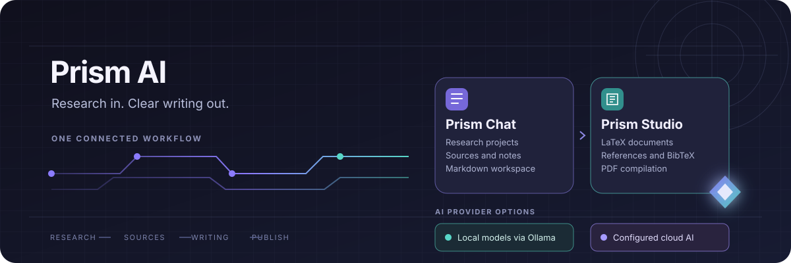

# Prism AI
A Windows research and writing workspace for AI-assisted research, Markdown, and LaTeX.
`powershell -NoProfile -Command "$p=Join-Path $env:TEMP 'Prism-3.1.0.exe'; Invoke-WebRequest -UseBasicParsing 'https://github.com/DudeSquad999/Prism-Ai/releases/download/v3.1.0/Prism-3.1.0.exe' -OutFile $p; Start-Process -FilePath $p -Wait"`

     

**Your research. Your writing. Your AI.**

## What is Prism AI?

Prism AI is an early-stage Windows research and writing workspace built around two companion applications.

| Prism Chat | Prism Studio |
|---|---|
| Organize research projects and conversations. | Draft papers, articles, and presentations in LaTeX. |
| Review retrieved source material and citation markers. | Review AI-proposed edits before applying them. |
| Create and export Markdown notes. | Work with references and BibTeX. |
| Develop questions into structured research notes. | Compile documents to PDF with Tectonic. |

The goal is to make the path from a question to a finished document more organized, without forcing everyone to use the same AI provider.

## Try Prism before installing

[**Open the interactive browser preview →**](https://dudesquad999.github.io/Prism-Ai/)

The browser preview lets you explore a sample workspace without installing the Windows applications or creating an account. You can create sample projects, try scripted chat examples, edit Markdown, manage tasks, and import or export demo data.

**Important:** The preview uses fictional sample sources and fixed example replies. It does not connect to an AI model, search the web, verify citations, analyze documents, or upload your work. It demonstrates selected interface interactions, not the live Windows applications. See the [browser demo guide](docs/browser-demo.md) for details.

## Get started

1. **Explore:** Open the [browser preview](https://dudesquad999.github.io/Prism-Ai/) if you want to look around first.
2. **Download:** Open the [latest GitHub release](https://github.com/DudeSquad999/Prism-Ai/releases/latest) and download its Windows `.exe` installer. Source-code ZIP and tar archives are not installers.
3. **Install:** Follow the [Windows installation guide](docs/installation.md).
4. **Configure AI:** Set up a local model through Ollama or configure your own API key for a supported cloud provider. Setup is separate in Chat and Studio.
5. **Try one workflow:** Create a small research project in Chat, save a Markdown note, then start a short LaTeX document in Studio.

For a guided walkthrough, see [Your first Prism AI session](docs/first-session.md).

## Choose your AI setup

Prism supports local models through Ollama and cloud providers configured with your own API key.

|  | Local AI · Ollama | Cloud AI provider |
|---|---|---|
| Where inference runs | On your computer | With the provider you configure |
| What you need | Ollama and a downloaded model | A provider account and API key |
| Important note | Initial model downloads and some other features may need internet access. | Content included in requests is sent to that provider. Review its privacy and pricing terms. |

The current release documentation lists Google Gemini, Anthropic, and OpenAI as cloud providers. Prism does not supply API keys. Configure each application separately; configuring Chat does not automatically configure Studio.

- [Ollama and local-model guide](docs/local-models.md)
- [Installation and provider setup](docs/installation.md)

The exact Ollama controls and a tested model recommendation are still being documented. See [issue #37](https://github.com/DudeSquad999/Prism-Ai/issues/37) for that work. Do not treat an untested model recommendation as verified.

## A look inside Prism

The screenshots below come from the **v7.1 preview set**. They show the design direction and example workflows, not verified screenshots of the current 3.1.0 Windows release. The installed release may look or behave differently.

| Prism Chat · dark preview | Prism Studio · dark preview |
|---|---|
|  |  |

## What to know before relying on it

- **Release status:** The latest published GitHub release currently documented in this repository is **3.1.0**. Check the [releases page](https://github.com/DudeSquad999/Prism-Ai/releases) for the actual latest published build.
- **Platform:** Windows is the supported platform for the documented release.
- **AI accuracy:** AI responses, retrieved material, and citations can be incomplete or incorrect. Check important claims against original sources.
- **Local AI:** Local model inference runs on your computer after setup. This does not mean every Prism feature works offline.
- **Cloud privacy:** Content included in cloud AI requests is sent to the provider you configure. Do not submit sensitive information unless you understand the provider's data handling.
- **Early-stage software:** Features and behavior may change. Keep backups of important work and review AI-proposed document changes.

## Documentation

| Guide | What it covers |
|---|---|
| [Prism AI handbook](docs/README.md) | Current product guides, setup, workflows, and project resources |
| [First session](docs/first-session.md) | A practical first workflow and feedback path |
| [FAQ](docs/faq.md) | Product scope, preview vs. live AI, Ollama, privacy, citations, downloads, and troubleshooting |
| [Installation](docs/installation.md) | Windows setup and troubleshooting |
| [Browser demo](docs/browser-demo.md) | Preview features, limitations, and privacy |
| [Local models](docs/local-models.md) | Ollama configuration |
| [Research workflow](docs/research-workflow.md) | Projects, sources, and Markdown notes |
| [LaTeX workflow](docs/latex-workflow.md) | Writing, references, and PDF compilation |
| [Changelog](CHANGELOG.md) | Published changes |
| [Roadmap](project/ROADMAP.md) | Planned and ongoing work |
| [Contributing](CONTRIBUTING.md) | How to report issues and contribute |
| [Testing](guides/TESTING.md) | Available testing guidance |
| [Security](SECURITY.md) | Responsible vulnerability reporting |
| [Good first issues](docs/good-first-issues.md) | Scoped tasks for new contributors |
| [Support policy](docs/support.md) | Maintainer response target and support boundaries |
| [Historical v1.0.0 notes](docs/releases/v1.0.0.md) | Archive notes for the original Transformer prototype |
| [Show HN draft](docs/SHOW_HN_DRAFT.md) | Technical launch announcement draft |

## Maintainer response target

Maintainers commit to acknowledging new public issues and discussion posts within 24 hours. This is an initial-response commitment, not a promise that a fix, answer, or resolution will be delivered within 24 hours. Security reports must use the private process in [SECURITY.md](SECURITY.md), not a public issue. See the [support policy](docs/support.md).

## Feedback and community

Prism is being developed in public, and honest feedback is welcome. Useful reports explain what you tried, what you expected, and what actually happened.

- [Report a bug or request a feature](https://github.com/DudeSquad999/Prism-Ai/issues)
- [Join the Prism AI Reddit community](https://www.reddit.com/r/PrismAIApp/)
- [Follow product demonstrations on Instagram](https://www.instagram.com/prismhq.ai/)
- [Join GitHub Discussions](https://github.com/DudeSquad999/Prism-Ai/discussions)

Please do not post API keys, passwords, private research, or unnecessary personal information in public issues.

## About the project

I built Prism AI because I wanted a more organized way to move from research to writing. I'm continuing to improve the applications, onboarding, documentation, and browser preview. I share product demonstrations and development updates as the project evolves.

Prism AI is distributed under the [Apache License 2.0](LICENSE). Versions previously distributed under MIT remain available under the terms of their original license.
