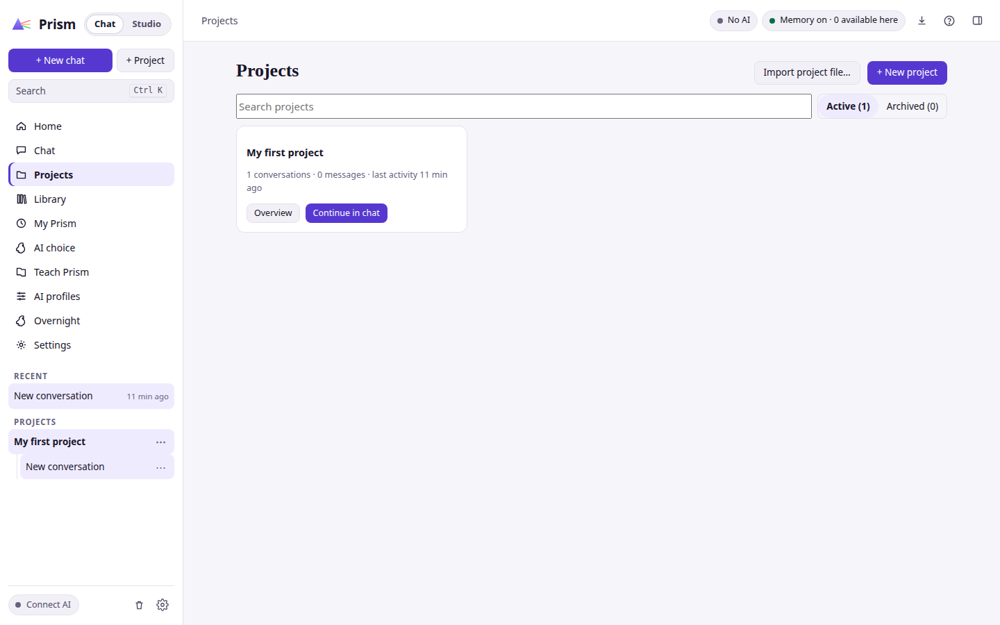
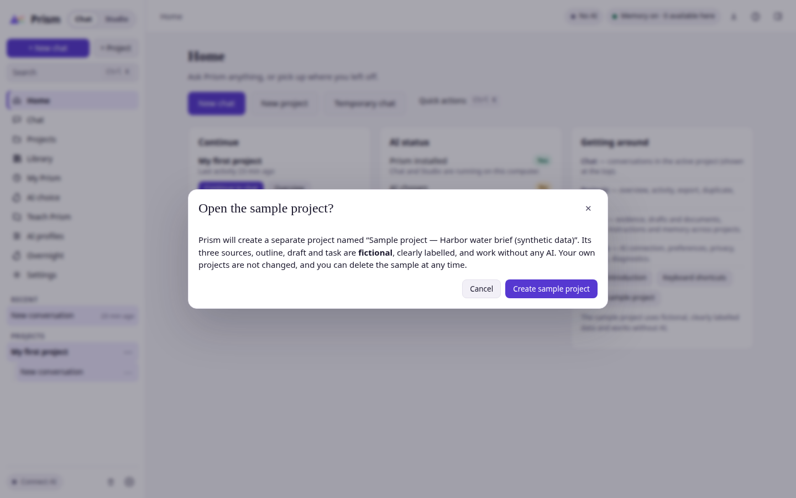
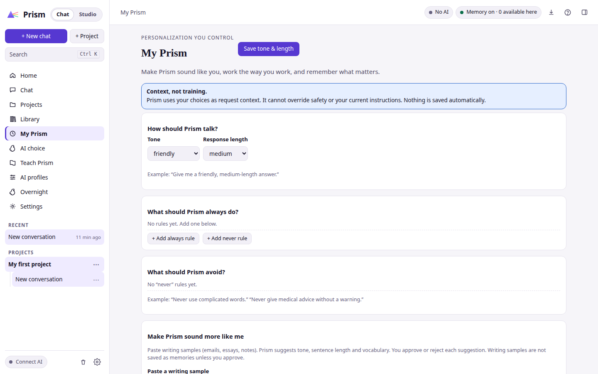
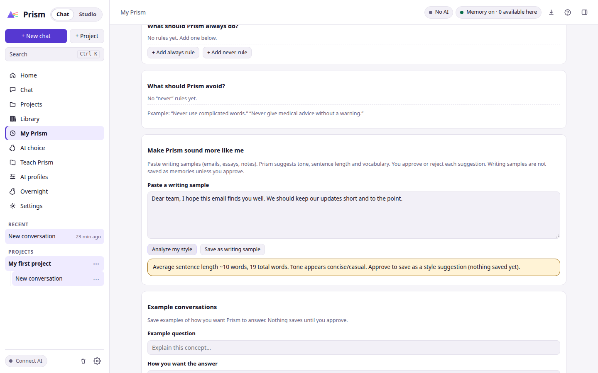
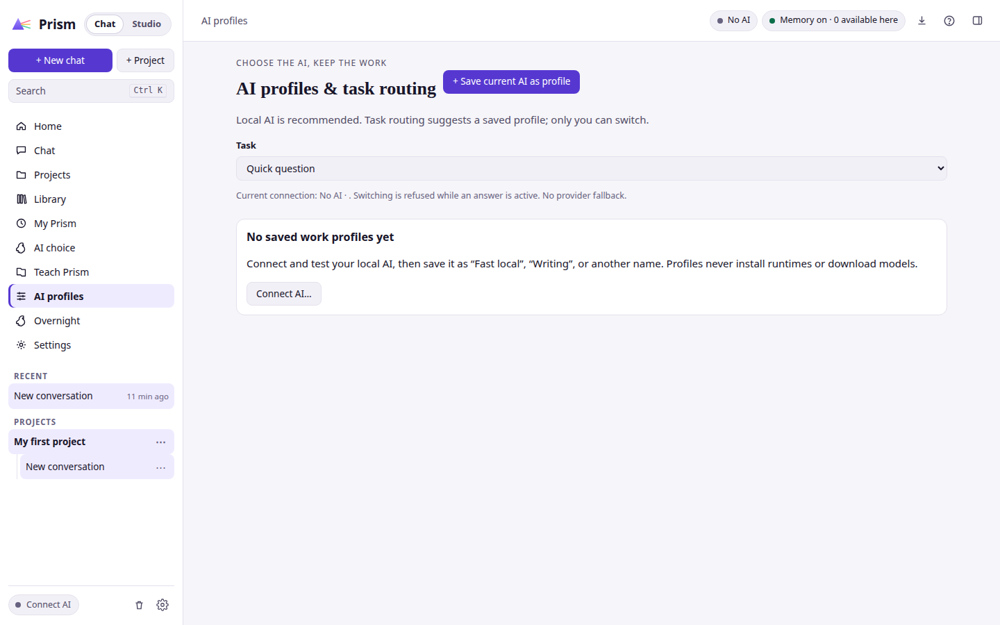
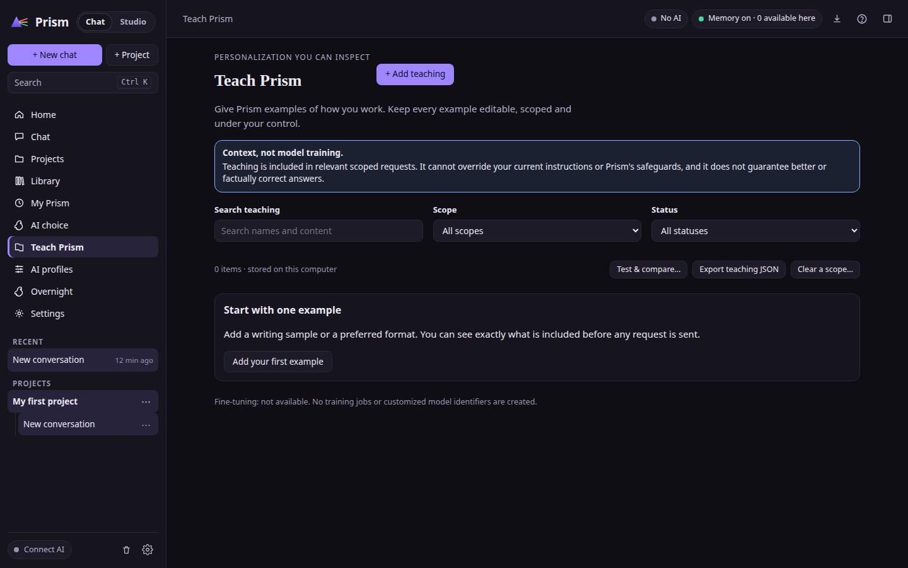
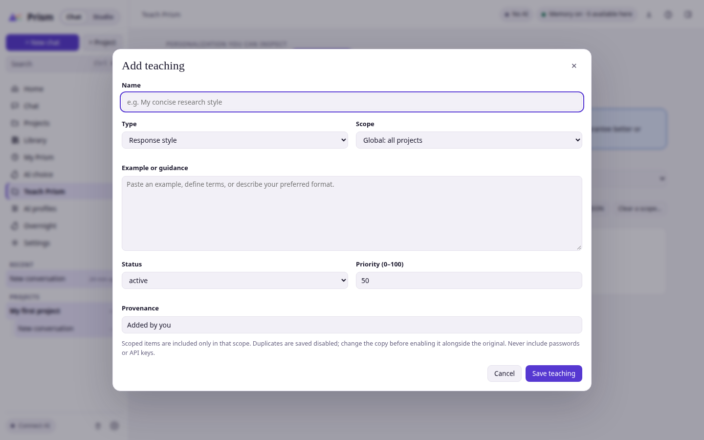
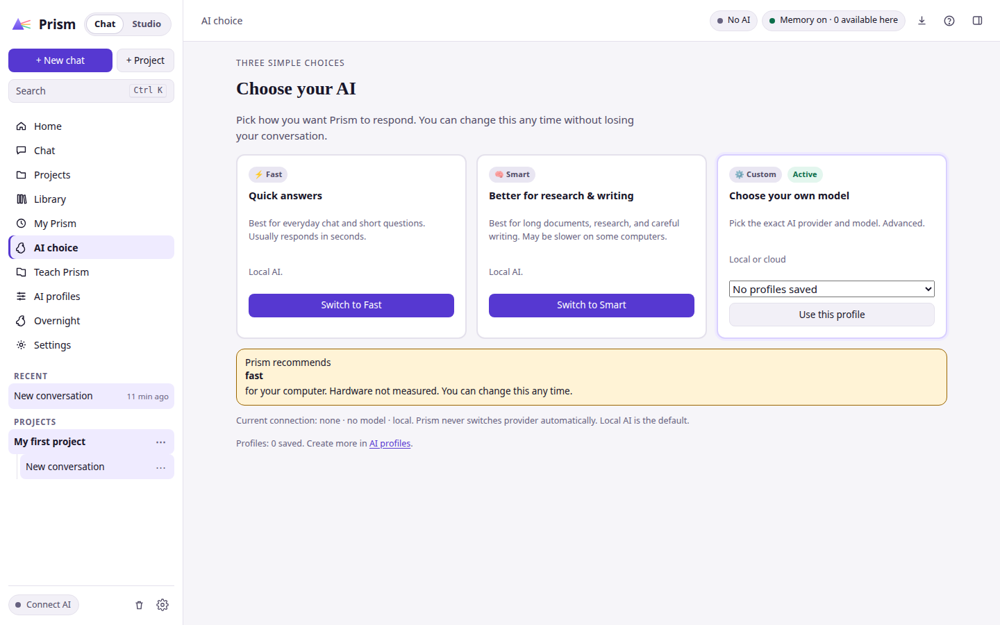
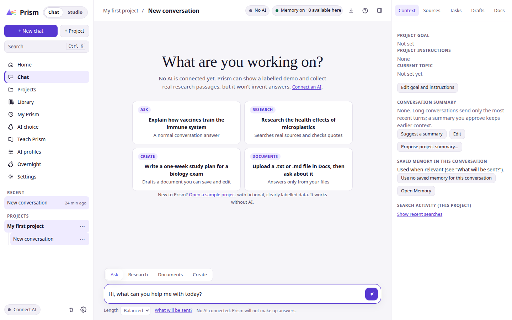
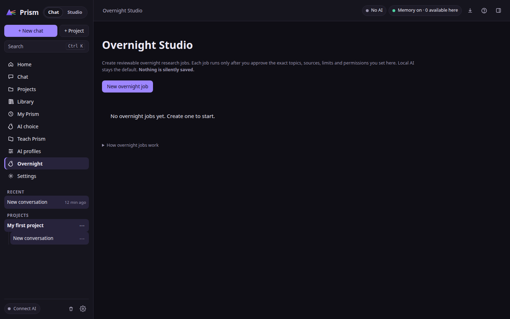

  
  <h1>Research deeply. Write with clarity.</h1>
  
<strong>A Windows workspace for AI-assisted research and LaTeX writing.</strong>

  

    
    
    
  

  

    <a href="https://github.com/DudeSquad999/Prism-Ai/releases/download/v3.1.0/Prism-3.1.0.exe"><strong>Download Prism AI 3.1.0</strong></a>
    · <a href="docs/installation.md">Installation guide</a>
    · <a href="https://dudesquad999.github.io/Prism-Ai/">Explore the browser preview</a>
  

Prism brings two desktop apps together: **Prism Chat** for conversations and research, and **Prism Studio** for LaTeX writing. Choose a local model through Ollama or connect a supported cloud provider. Keep your work organized from the first research question through the final paper.

> **About this release:** Prism AI 3.1.0 is an early-stage Windows release. The screenshots in this README are supplied v7.1 preview images and may not match the released applications. See the [3.1.0 changelog](CHANGELOG.md) for confirmed release details.11

## Get started

1. **Download:** Get the [Prism AI 3.1.0 Windows installer](https://github.com/DudeSquad999/Prism-Ai/releases/download/v3.1.0/Prism-3.1.0.exe) from [GitHub Releases](https://github.com/DudeSquad999/Prism-Ai/releases/tag/v3.1.0). Choose the `.exe` installer, not a source-code archive.
2. **Install:** Launch Prism Chat or Prism Studio after setup.
3. **Connect AI:** Configure [Ollama for local models](docs/local-models.md), or add your own API key for Google Gemini, Anthropic, or OpenAI.
4. **Start a project:** Explore and organize research in Chat, then use Studio when you are ready to write.

The full [installation and troubleshooting guide](docs/installation.md) covers setup, provider configuration, and PDF compilation.

## Two apps, one workflow

| Prism Chat | Prism Studio |
|---|---|
| Organize research projects, conversations, and notes. | Draft papers, articles, and Beamer presentations in LaTeX. |
| Explore research and review retrieved sources. | Review proposed edits before applying them. |
| Create, edit, save, and export Markdown notes. | Find related work, check references, and compile PDFs with Tectonic. |
| Move outlines and project material into your writing workflow. | Import and export project ZIP files, including Overleaf-compatible projects. |

### Choose how AI runs

| Local models with Ollama | Cloud providers |
|---|---|
| Model inference runs on your computer after setup. Model downloads and some research features may still need an internet connection. | Prism 3.1.0 supports Google Gemini, Anthropic, and OpenAI with your own API key. Requests containing your content go to the provider you configure. |

For research workflows, see [Organize sources and create notes](docs/research-workflow.md). For LaTeX, references, and PDFs, see [Write and compile documents](docs/latex-workflow.md).

## Preview the interface

These supplied screenshots show a **v7.1 preview**, not a recording or verified representation of Prism AI 3.1.0. They illustrate the product's intended workflows; screens and features may differ in the released Windows apps. Select any image to view it full size.

<strong>01 · Home, chat, and projects</strong>

| Home · dark | Home · light |
|---|---|
|  |  |

| Chat · dark | Chat · light |
|---|---|
|  |  |

| Projects · dark | Projects · light |
|---|---|
|  |  |

The sample project in this preview is labeled fictional and kept separate from personal work:

<strong>02 · Research and personalization</strong>

| Evidence library | My Prism · dark | My Prism · light |
|---|---|---|
|  |  |  |

| Writing-style review | AI profiles · dark | AI profiles · light |
|---|---|---|
|  |  |  |

| Teach Prism | Add a teaching item |
|---|---|
|  |  |

<strong>03 · AI settings, writing, and example workflows</strong>

| AI choice · dark | AI choice · light |
|---|---|
|  |  |

| Prism Studio · dark | Prism Studio · light |
|---|---|
|  |  |

| Chat prompt · preview | Overnight planning · preview |
|---|---|
|  |  |

## Privacy and important limitations

- **Local AI:** With Ollama configured, model inference runs locally. Initial model downloads and some research features still require internet access.
- **Cloud AI:** Requests containing your content are sent to the provider you configure. Review its privacy, pricing, and usage terms.
- **Research quality:** Retrieved excerpts and matching quotes are useful evidence to inspect, not proof that a broader claim is correct. Verify important conclusions against original sources.
- **PDFs:** Prism Studio uses Tectonic to compile PDFs. Initial TeX package downloads may need an internet connection.
- **Early-stage software:** Features and behavior may change between releases. AI responses and citations can be incorrect.
- **Browser preview:** The browser preview is a separate demonstration with fixed examples. It does not connect to AI models or represent the live desktop applications.

Never include API keys, passwords, private research, or personal information in public issues, logs, or screenshots.

## Documentation

| Guide | What it covers |
|---|---|
| [Install Prism AI on Windows](docs/installation.md) | Installer, AI configuration, and troubleshooting |
| [Use Prism AI with Ollama](docs/local-models.md) | Local model setup, inference, and internet requirements |
| [Research and Markdown notes](docs/research-workflow.md) | Projects, retrieved sources, and notes |
| [LaTeX writing and PDFs](docs/latex-workflow.md) | Documents, references, revisions, and compilation |
| [Browser preview](docs/browser-demo.md) | What the static browser demo does and does not do |
| [Changelog](CHANGELOG.md) | Confirmed release information |
| [Roadmap](project/ROADMAP.md) | Development plans, not release guarantees |

## Contributing and support

Bug reports, documentation fixes, and usability feedback are welcome. Read [CONTRIBUTING.md](CONTRIBUTING.md) before opening a pull request. Report product issues on [GitHub Issues](https://github.com/DudeSquad999/Prism-Ai/issues). For security concerns, follow [SECURITY.md](SECURITY.md) and do not post vulnerabilities publicly.

## License

Prism AI is released under the [MIT License](LICENSE).
