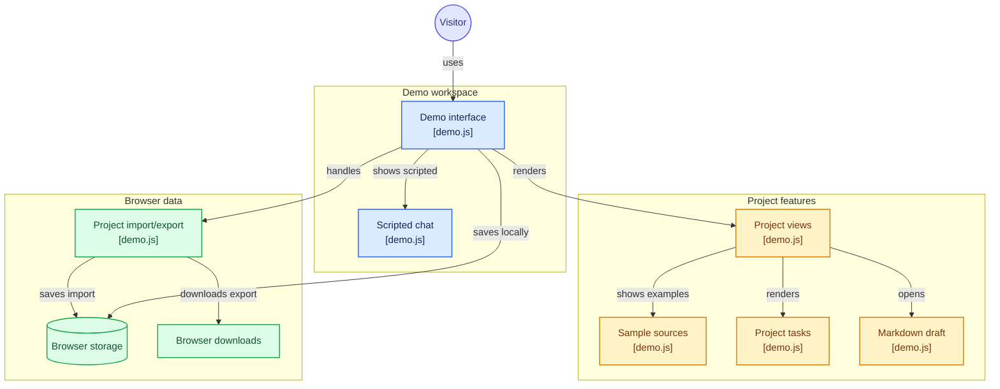

  
  <h1>Prism AI</h1>
  <h3>Research and LaTeX writing for Windows</h3>
  
<strong>Your research. Your writing. Your AI.</strong>

  
A connected workspace for exploring ideas, organizing research, and developing polished academic documents.

  

    
    
    
  

  

    <a href="https://github.com/DudeSquad999/Prism-Ai/releases/latest"><strong>Download Prism AI</strong></a>
    · <a href="https://dudesquad999.github.io/Prism-Ai/">Explore the browser demo</a>
    · <a href="docs/installation.md">Read the installation guide</a>
  

---

## Overview

Prism AI is an early-stage Windows research and writing workspace built around two companion applications:

- **Prism Chat** helps you explore questions, organize research projects, keep conversations and source material together, and write Markdown notes.
- **Prism Studio** helps you draft papers and presentations in LaTeX, review AI-proposed edits, manage references, and compile PDFs.

Choose a local model through Ollama or connect your own supported cloud AI provider. Prism is designed to keep research and writing in one workflow while leaving decisions about sources, edits, and AI providers in your hands.

> **Release note:** The current documented Windows release is **3.1.0**. Prism AI is still early-stage software. Review the [changelog](CHANGELOG.md), [installation guide](docs/installation.md), and limitations described below before relying on it for important work.

## At a glance

| Prism Chat | Prism Studio |
|---|---|
| Research projects and conversations | LaTeX papers and presentations |
| Source cards and research notes | Reviewable writing suggestions |
| Markdown editing and exports | Reference lookup and BibTeX |
| Research-to-outline workflow | PDF compilation with Tectonic |

## Explore the browser demo

[**Open the interactive browser demo →**](https://dudesquad999.github.io/Prism-Ai/)

The browser demo is a free, static preview that runs without an account, API key, or installation. You can create sample projects, explore scripted chat examples, edit Markdown drafts, manage tasks, and import or export demo data.

**Demo boundaries:** The preview uses fictional sample sources and fixed example replies. It does not connect to an AI model, search the web, verify citations, analyze documents, or upload your work. Changes are saved in your browser's local storage. See the [browser demo guide](docs/browser-demo.md) for details.

## Browser demo architecture

The diagram below describes the browser-only preview implemented in [`demo.js`](demo.js). It maps the demo interface, scripted chat, project views, sample sources, tasks, Markdown drafts, import/export, browser storage, and downloads. It is not an architecture diagram for the full Windows applications or the separate private Prism web backend.

<strong>View the Mermaid source</strong>

Generated with [GitDiagram](https://gitdiagram.com/dudesquad999/prism-ai).

## Product workflow

| Step | What happens |
|---|---|
| **01 · Explore** | Investigate a question and develop ideas in Prism Chat. |
| **02 · Organize** | Keep conversations, retrieved material, and Markdown notes with a research project. |
| **03 · Develop** | Shape an outline into a paper or presentation in Prism Studio. |
| **04 · Deliver** | Review edits, check references, and compile the document to PDF. |

## Core capabilities

### Prism Chat · Research and organization

- Create research projects and keep related conversations and notes together.
- Explore questions and review source cards and citation markers.
- Work with article extracts and scholarly abstracts from sources that include Wikipedia and Crossref, with optional Tavily or OpenAlex sources.
- Create, edit, save, download, and export Markdown notes and research material.

### Prism Studio · LaTeX writing

- Draft academic papers, articles, and Beamer presentations.
- Review proposed edits before accepting, rejecting, or undoing them.
- Search related work using arXiv and Crossref, retrieve BibTeX, and check references.
- Compile PDFs with Tectonic.
- Import and export project ZIP files, including Overleaf-compatible projects.

AI-generated text, retrieved material, and citations can be incomplete or incorrect. Check original sources and review document changes before submitting or publishing work.

## Choose your AI setup

Prism supports two approaches to AI. Availability and performance depend on the application, provider configuration, model, and your hardware.

|  | Local AI · Ollama | Cloud AI provider |
|---|---|---|
| **Providers** | Models served by Ollama | Google Gemini, Anthropic, or OpenAI |
| **Where processing happens** | On your computer | With the cloud provider you configure |
| **What you need** | Ollama and a compatible downloaded model | Your provider account and API key |
| **Important considerations** | Model downloads require internet access; local inference does not make every feature offline. | Content included in requests is sent to your selected provider. Review its privacy, pricing, and usage terms. |

Prism does not supply cloud API keys. Configure the provider separately in each application you use; configuring Prism Chat does not necessarily configure Prism Studio.

- [Ollama and local-model setup](docs/local-models.md)
- [Full installation and provider configuration](docs/installation.md)

## Screenshots

The images below are from a supplied **v7.1 preview set**. They illustrate the intended interface and workflows; they are not verified screenshots of the 3.1.0 release, and the actual release screens or features may differ.

| Prism Chat · dark preview | Prism Studio · dark preview |
|---|---|
|  |  |

| Prism home · dark preview | Prism projects · dark preview |
|---|---|
|  |  |

<strong>Explore the full screenshot gallery</strong> · 21 supplied preview images

### Home, chat, and projects

| Home · dark | Home · light |
|---|---|
|  |  |

| Chat · dark | Chat · light |
|---|---|
|  |  |

| Projects · dark | Projects · light |
|---|---|
|  |  |

The sample project in this preview is labeled fictional and kept separate from personal work:

### Research and personalization

| Evidence library | My Prism · dark | My Prism · light |
|---|---|---|
|  |  |  |

| Writing-style review | AI profiles · dark | AI profiles · light |
|---|---|---|
|  |  |  |

| Teach Prism | Add a teaching item |
|---|---|
|  |  |

### AI setup, writing, and workflow previews

| AI choice · dark | AI choice · light |
|---|---|
|  |  |

| Prism Studio · dark | Prism Studio · light |
|---|---|
|  |  |

| Chat prompt · preview | Overnight planning · preview |
|---|---|
|  |  |

## Get started

1. **Download the installer.** Open the [latest GitHub release](https://github.com/DudeSquad999/Prism-Ai/releases/latest) and download the Windows `.exe` asset. GitHub's source-code ZIP and tar archives are not installers.
2. **Install and launch.** Follow the installer prompts. Open Prism Chat for research and Markdown work, or Prism Studio for LaTeX writing.
3. **Configure AI.** Set up [Ollama](docs/local-models.md) with a local model, or provide your own API key for a supported cloud provider. Configure each application you plan to use.
4. **Run a small test.** Start with non-sensitive sample content and confirm that the selected AI provider responds. A scripted or offline demo response is not proof of a live connection.
5. **Verify PDF output.** In Prism Studio, compile a small document to confirm that Tectonic is configured. AI connectivity and PDF compilation are separate checks.

For detailed steps and troubleshooting, see the [Windows installation guide](docs/installation.md).

## Documentation

| Resource | Description |
|---|---|
| [Documentation index](docs/README.md) | Overview of the available guides |
| [Installation guide](docs/installation.md) | Windows setup and troubleshooting |
| [Local models with Ollama](docs/local-models.md) | Configure local AI |
| [Research workflow](docs/research-workflow.md) | Organize research and notes |
| [LaTeX workflow](docs/latex-workflow.md) | Write and compile documents |
| [Browser demo guide](docs/browser-demo.md) | Demo features, storage, import, and privacy |
| [Project roadmap](project/ROADMAP.md) | Planned and ongoing project direction |
| [Changelog](CHANGELOG.md) | Release history and changes |
| [Testing guide](guides/TESTING.md) | Available test information |

## Current status and limitations

- **Early-stage release:** Prism AI 3.1.0 is an early-stage Windows release. Features and behavior may change.
- **Platform:** Windows is the supported platform for this release.
- **Screenshots:** The screenshots in this README come from the v7.1 preview set and may not match 3.1.0.
- **AI reliability:** AI responses, retrieved sources, and citations may be incomplete or wrong. Verify important claims against original sources.
- **Internet access:** Local model inference runs on your computer after setup, but research retrieval, initial model downloads, and first-time TeX package downloads may still require internet access.
- **Cloud privacy:** When you use a cloud provider, content included in your requests is sent to that provider. Review its data-handling policies before sharing sensitive material.

See the [3.1.0 changelog](CHANGELOG.md) and the guides for more detail.

## Contributing and support

Bug reports, documentation improvements, setup feedback, and focused contributions are welcome.

- [Report a bug or request a feature](https://github.com/DudeSquad999/Prism-Ai/issues)
- [Read the contribution guide](CONTRIBUTING.md)
- [Review the security policy](SECURITY.md)
- [Join the Prism AI community on Reddit](https://www.reddit.com/r/PrismAIApp/)

Please include reproducible steps when reporting a problem. Never post API keys, passwords, private research, or personal information in public issues.

## License

Prism AI is distributed under the [Apache License 2.0](LICENSE). Versions previously distributed under MIT remain available under the terms of their original license.

---

  <strong>Prism AI</strong> 
  Research deeply. Write with clarity.

