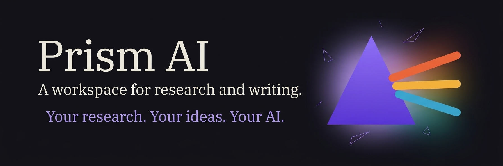
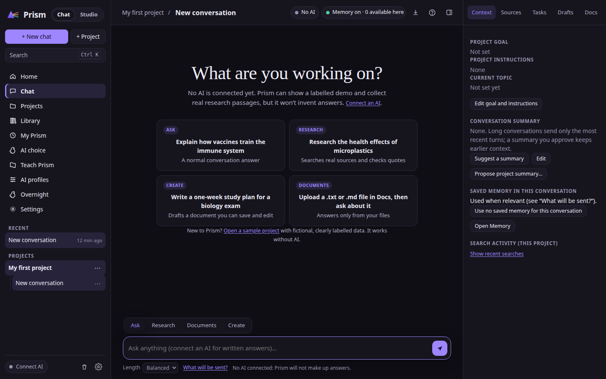
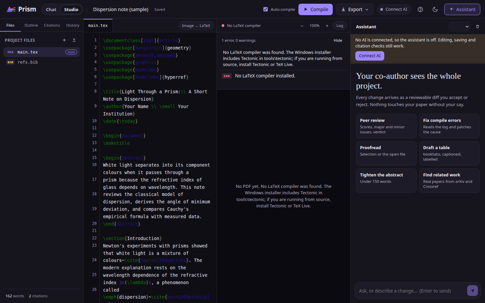

# Prism AI

Windows research and LaTeX workspace with local and cloud AI.

**Install on Windows (PowerShell):**

```powershell
irm [https://raw.githubusercontent.com/DudeSquad999/Prism-Ai/Main/scripts/install.ps1](https://raw.githubusercontent.com/DudeSquad999/Prism-Ai/Main/scripts/install.ps1) | iex
```

<p align="center">
  
</p>

<p align="center"> <a href="LICENSE"></a> <a href="https://github.com/DudeSquad999/Prism-Ai/actions/workflows/ci.yml"></a> <a href="docs/support.md"></a></p>

**Your research. Your writing. Your AI.**

## What Prism AI does

Prism AI is a Windows research and writing workspace built around two companion applications:

- **Prism Chat** organizes research projects, conversations, source material, and Markdown notes.
- **Prism Studio** supports LaTeX papers and presentations, reference management with BibTeX, and PDF compilation with Tectonic.
- **AI configuration** supports local models through Ollama and cloud providers configured with your own API key.

The goal is to make the path from a research question to a finished document easier to manage while keeping provider choice and review of AI-proposed edits in the user's hands.

## Install Prism AI

The one-command PowerShell installer downloads the published v3.1.0 Windows installer, verifies its SHA-256 digest, and then opens it. It is pinned to the verified v3.1.0 asset. Update the script's version and digest together when a new installer is published.

For a manual install, open the [latest GitHub release](https://github.com/DudeSquad999/Prism-Ai/releases/latest) and download the Windows `.exe` asset. GitHub's automatically generated source archives are not Windows installers.

- [Windows installation guide](docs/installation.md)
- [Published releases](https://github.com/DudeSquad999/Prism-Ai/releases)

## Try the browser preview

[Open the interactive browser preview](https://dudesquad999.github.io/Prism-Ai/).

The browser workspace lets you explore Prism without installing the Windows applications or creating an account. It includes projects, conversations, Markdown drafts, tasks, Perspectives, and project import and export. You can also connect directly to an Ollama model running on your own computer for live AI chat.

Without Ollama, Chat uses clearly labeled sample responses. The browser workspace does not include live web search, citation verification, or document uploads, and it does not replace the native Windows applications. Read the [browser workspace guide](docs/browser-demo.md).

## First session

1. Read [Your first Prism AI session](docs/first-session.md).
2. Create a small research project in Prism Chat.
3. Organize source material and save a Markdown note.
4. Open Prism Studio and start a short LaTeX document.
5. Review any AI-proposed edits before applying them.

## Choose an AI setup

**Local AI with Ollama**
- Model inference runs on your computer after setup.
- You need Ollama and a downloaded model.
- Initial model downloads and some other features may require internet access.

**Cloud AI provider**
- Configure your own API key for a supported provider.
- Content included in requests is sent to that provider.
- Review provider privacy, pricing, and data-handling terms before use.

The v3.1.0 release documentation lists Google Gemini, Anthropic, and OpenAI as cloud providers. Prism does not supply API keys. Configure each application separately; configuring Chat does not automatically configure Studio.

- [Ollama and local-model guide](docs/local-models.md)
- [Installation and provider setup](docs/installation.md)
- [Issue #37: verify Ollama setup in Chat and Studio](https://github.com/DudeSquad999/Prism-Ai/issues/37)

Do not treat an untested model recommendation or an unverified provider workflow as confirmed.

## Screenshots

The current gallery in the documentation uses the **v7.1 preview set**. These images show the design direction and example workflows. They are not verified screenshots of the current 3.1.0 Windows release, and the installed release may look or behave differently.

| Prism Chat preview | Prism Studio preview |
|---|---|
| [](docs/screenshots/v71_chat_1440x900_dark.png) | [](docs/screenshots/v71_studio_1440x900_dark.png) |

## Release status and limitations

- **Current documented Windows release:** 3.1.0. Check the [releases page](https://github.com/DudeSquad999/Prism-Ai/releases) for the latest published build.
- **Supported platform:** Windows for the documented desktop release.
- **AI accuracy:** AI responses, retrieved material, and citations can be incomplete or incorrect. Verify important claims against original sources.
- **Local AI:** Local inference does not mean every Prism feature works offline.
- **Cloud privacy:** Content included in cloud requests is sent to the provider you configure. Do not submit sensitive information unless you understand that provider's data handling.
- **Early-stage software:** Features and behavior may change. Keep backups of important work and review AI-proposed document changes.

## Repository scope and licensing

This public repository contains the browser preview, documentation, repository automation, and project records. The complete source for the packaged Windows applications is not currently included in this static-preview repository. Editing the browser preview does not modify Prism Chat or Prism Studio.

The Apache License 2.0 applies to the files covered by the license in this repository. It does not automatically apply to omitted components, third-party software, or assets distributed separately. Check the notices and license terms accompanying each release. Earlier MIT-licensed versions remain under their original terms.

## Documentation

<details>
<summary>Product guides and technical project documentation</summary>

- [Prism AI handbook](docs/README.md)
- [First session](docs/first-session.md)
- [FAQ](docs/faq.md)
- [Installation](docs/installation.md)
- [Browser demo](docs/browser-demo.md)
- [Local models](docs/local-models.md)
- [Research workflow](docs/research-workflow.md)
- [LaTeX workflow](docs/latex-workflow.md)
- [Project structure and file ownership](docs/PROJECT_STRUCTURE.md)
- [Testing guidance and report](guides/TESTING.md)
- [Getting started for maintainers](guides/GETTING_STARTED.md)
- [Roadmap](project/ROADMAP.md)
- [Brand positioning strategy](project/BRAND_POSITIONING.md)
- [Original project architecture notes](project/Prism-Ai-How-I-Want-It-To-Work.md)
- [LLM architecture comparison](project/How-LLMs-Work-Comparison.md)
- [Changelog](CHANGELOG.md)
- [Historical v1.0.0 release notes](docs/releases/v1.0.0.md)
- [Contributing](CONTRIBUTING.md)
- [Security policy](SECURITY.md)
- [Support policy](docs/support.md)
- [Good first issues](docs/good-first-issues.md)
- [Security audit](docs/SECURITY_AUDIT.md)
- [Show HN draft](docs/SHOW_HN_DRAFT.md)

</details>

## Support and community

The maintainer commits to acknowledge actionable public issues and private security reports within 24 hours of receipt. This is an acknowledgement commitment, not a guarantee of a fix or resolution within 24 hours. Read the [support policy](docs/support.md).

- [Report a bug or request a feature](https://github.com/DudeSquad999/Prism-Ai/issues)
- [GitHub Discussions](https://github.com/DudeSquad999/Prism-Ai/discussions)
- [Prism AI Reddit community](https://www.reddit.com/r/PrismAIApp/)
- [Product demonstrations on Instagram](https://www.instagram.com/prismhq.ai/)

Do not post API keys, passwords, private research, private conversations, or unnecessary personal information in public issues.

## Contributing

Read [CONTRIBUTING.md](CONTRIBUTING.md) before making changes. Focused documentation, accessibility, testing, and browser-preview contributions are welcome. The [good first issues](docs/good-first-issues.md) page lists scoped starting points.

## Historical release notes

The original [v1.0.0 release](https://github.com/DudeSquad999/Prism-Ai/releases/tag/v1.0.0) was an educational PyTorch Transformer prototype. It is not the current Windows research and writing product. See the [archived v1.0.0 notes](docs/releases/v1.0.0.md).
