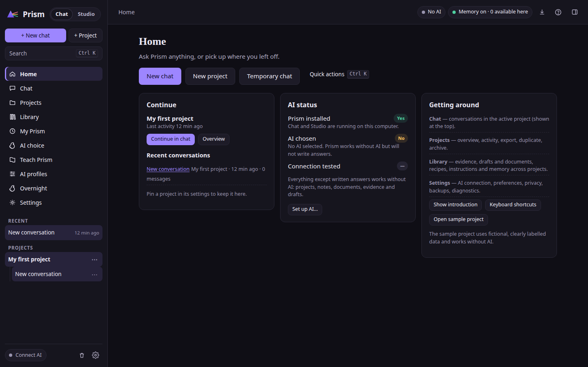
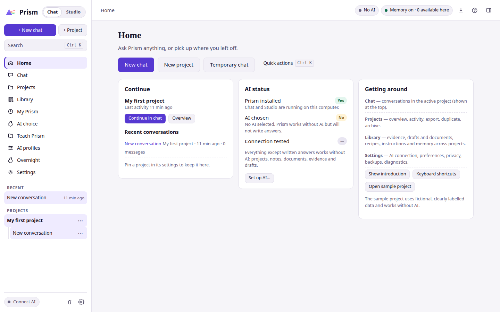
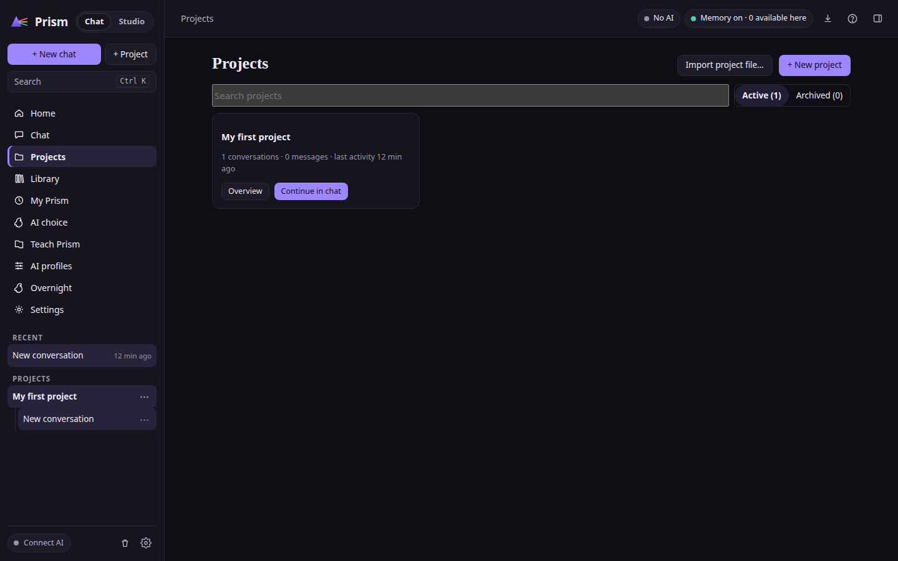
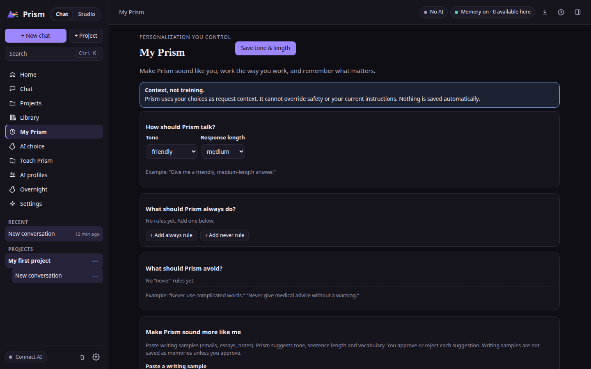
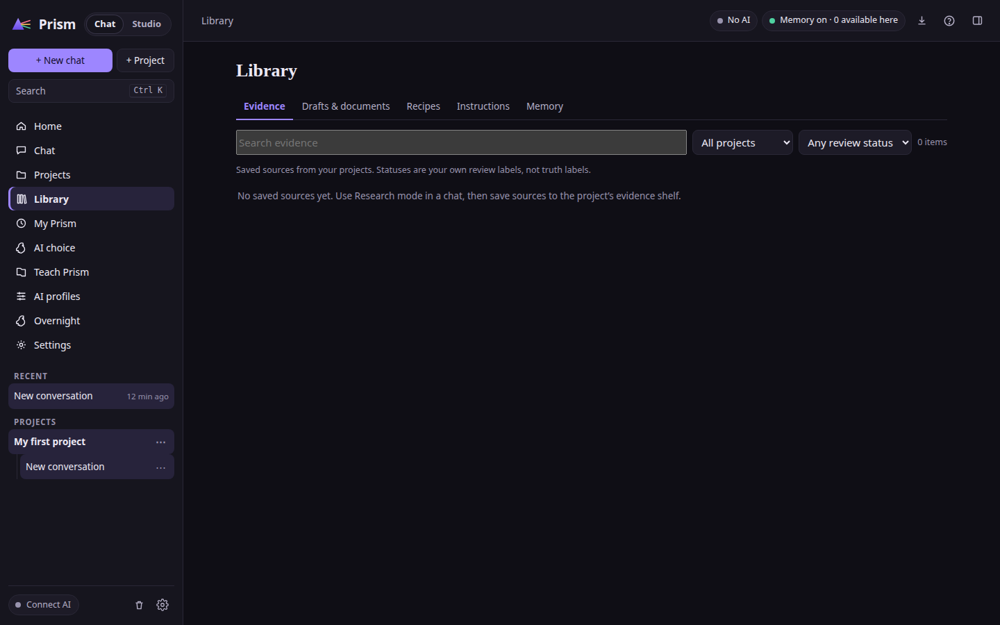
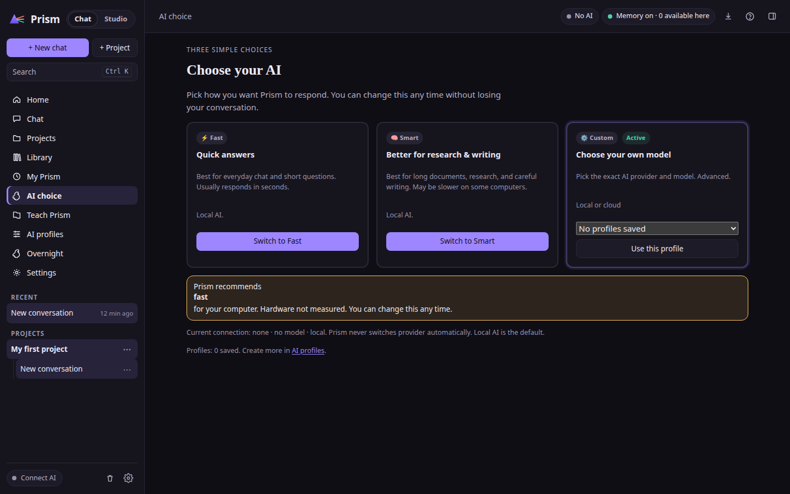
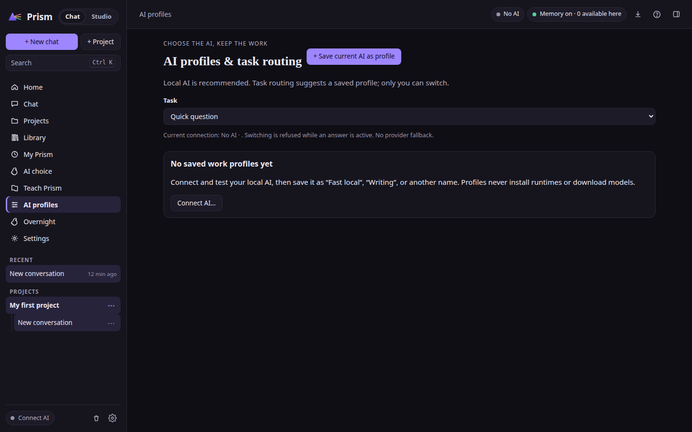
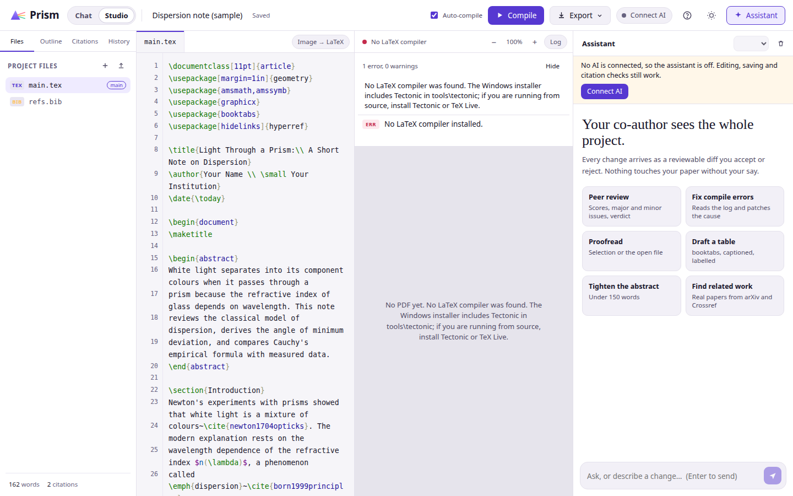
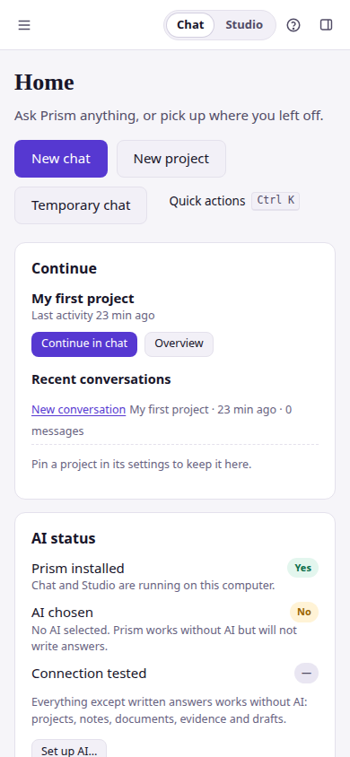
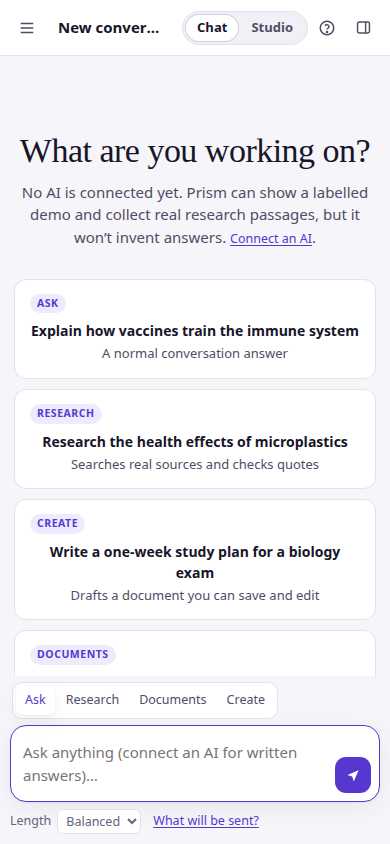

# Prism AI

**A Windows workspace for research, AI-assisted writing, and LaTeX documents.**

Prism AI brings research projects, conversations, source material, Markdown notes, and document writing together. Use a configured local model through Ollama or connect a supported cloud provider. Prism includes two desktop apps—**Prism Chat** and **Prism Studio**—plus a [static browser preview](https://dudesquad999.github.io/Prism-Ai/).

[Download the latest Windows release](https://github.com/DudeSquad999/Prism-Ai/releases/latest) · [Browse the screenshots](#screenshots) · [Read the setup guide](docs/installation.md) · [Report a problem](https://github.com/DudeSquad999/Prism-Ai/issues)

> **New here?** Start with the [latest Windows installer](https://github.com/DudeSquad999/Prism-Ai/releases/latest), then follow the [installation and AI setup guide](docs/installation.md). Release asset names can change; choose the installer attached to the latest release, not the source-code archive.

## What you can do

| Prism Chat | Prism Studio |
|---|---|
| Organize research by project and conversation. | Draft and revise papers, articles, and Beamer presentations in LaTeX. |
| Search supported sources and review retrieved extracts and abstracts. | Review, accept, reject, or undo proposed AI edits. |
| Follow citation markers to source cards and inspect matching passages. | Find related work and retrieve BibTeX references. |
| Create, edit, save, and export Markdown notes and conversations. | Compile PDFs with Tectonic and import or export project ZIP files. |

Prism Chat supports research and writing workflows; Prism Studio focuses on LaTeX authoring and compilation. See the [research guide](docs/research-workflow.md) and [Studio guide](docs/latex-workflow.md) for step-by-step instructions.

## Screenshots

Screenshots below show the Windows applications in the v7.1 screenshot set. Select an image to view it at full size.

<strong>Prism Chat — Home, conversations, and projects</strong>

| Home · dark | Home · light |
|---|---|
|  |  |

| Chat · dark | Chat · light |
|---|---|
|  |  |

| Projects | My Prism |
|---|---|
|  |  |

<strong>Research and writing tools</strong>

| Evidence library | AI choice | AI profiles |
|---|---|---|
|  |  |  |

| Prism Studio · dark | Prism Studio · light |
|---|---|
|  |  |

<strong>Narrow-screen layouts</strong>

| Home · mobile | Chat · mobile |
|---|---|
|  |  |

## Get started on Windows

1. Download the installer from [Prism AI Releases](https://github.com/DudeSquad999/Prism-Ai/releases/latest). Choose the Windows installer asset; source-code ZIP files are for developers.
2. Run the installer and open Prism Chat or Prism Studio.
3. Configure a local model through [Ollama](docs/local-models.md) or add a supported cloud-provider API key.
4. Create a project in Prism Chat to organize conversations and research; open Prism Studio to write or compile a LaTeX document.

The [installation guide](docs/installation.md) has detailed setup and troubleshooting instructions.

## AI, privacy, and limitations

- **Local models:** With Ollama configured, model inference runs on your computer. Model downloads and some research features may still require an internet connection.
- **Cloud providers:** Requests containing your content go to the provider you configure. Review that provider’s privacy, pricing, and usage terms.
- **Research:** Prism can retrieve article extracts and scholarly abstracts from supported sources. A matching quote does not prove a broader claim; check important sources and conclusions yourself.
- **Early-stage software:** Features may change between releases. AI output and citations can be incorrect, and PDF compilation requires a configured TeX engine.
- **Browser preview:** The browser preview is a separate static demonstration with fixed examples. It does not connect to models or represent the live desktop applications.

Do not post API keys, passwords, private research, or personal information in public issues or screenshots.

## Documentation

| Guide | Description |
|---|---|
| [Install Prism AI on Windows](docs/installation.md) | Installer, AI configuration, and troubleshooting |
| [Use Prism AI with Ollama](docs/local-models.md) | Configure local models and understand local inference |
| [Research and Markdown notes](docs/research-workflow.md) | Organize projects, review sources, and create notes |
| [Write and compile LaTeX documents](docs/latex-workflow.md) | Use Prism Studio for writing, references, and PDFs |
| [Browser preview](docs/browser-demo.md) | What the static browser demo does and does not do |
| [Changelog](CHANGELOG.md) | User-visible changes by release |
| [Roadmap](project/ROADMAP.md) | Development plans (not release guarantees) |

## Contributing

Bug reports, documentation improvements, and usability feedback are welcome. Read [CONTRIBUTING.md](CONTRIBUTING.md) before opening a pull request. For security concerns, follow [SECURITY.md](SECURITY.md) and do not post vulnerabilities publicly.

## License

See [LICENSE](LICENSE).
